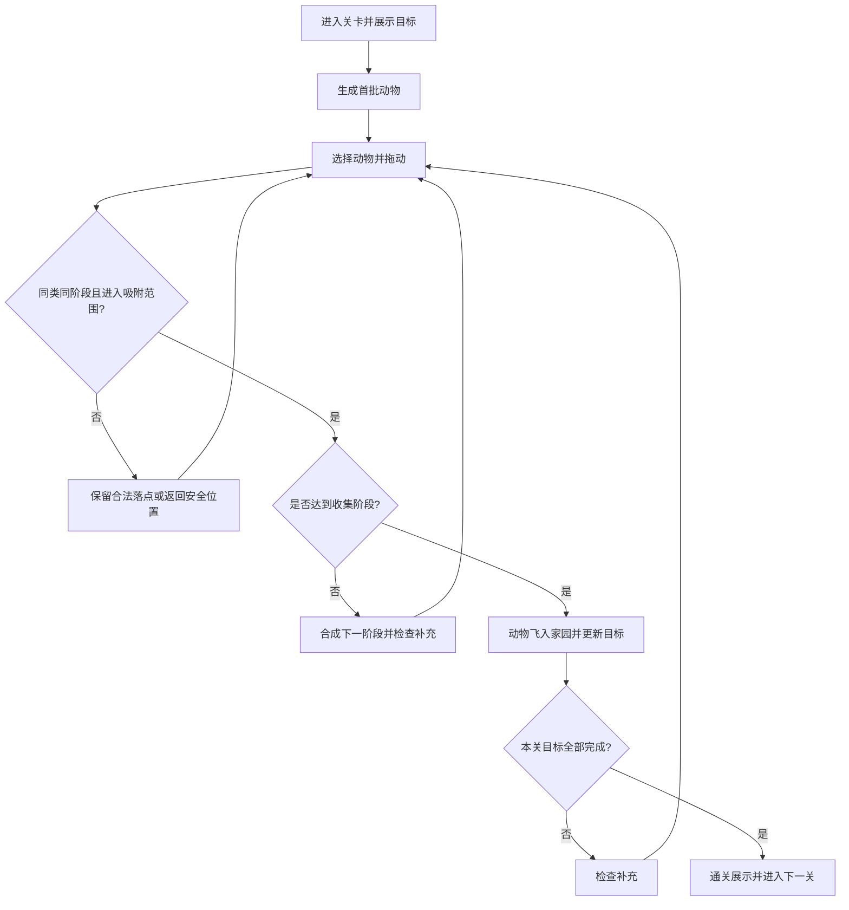

# 动物合合乐｜玩法 PRD V1.0

- 项目名称：动物合合乐（工作名，正式名称待定）
- 文档日期：2026-11-02
- 目标平台：手机端小游戏，竖屏，触屏单指操作
- 开发方向：Cocos Creator 2D
- 美术方向：2D 欧美治愈卡通
- 文档用途：玩法确认、UI 设计、素材规划、灰盒开发及验收
- 状态：已确认核心方向；本文给出的数值、补充算法及关卡配置为首版设计基线，需要通过灰盒试玩调整。

> 本方案参考用户提供的 PC 海洋生物合成视频，保留寻找同类、拖动合成、逐步上色、自动收集的循环。视频没有完整展示全部原版规则；以下内容是本项目明确采用的设计，不声称是原版游戏的完整还原。

## 1. 产品定位

### 1.1 一句话玩法

在散落的小动物中寻找同类，将同阶段的两只拖到一起合成，让动物逐步变得鲜活，最终送进家园；体型越大的动物，需要完成的合成层数越多。

### 1.2 核心体验

1. 找到相同动物的轻度观察乐趣。
2. 两只动物靠拢、轻压、弹起的触觉联想。
3. 从米白线稿到完整彩色的视觉奖励。
4. 动物飞进家园、逐个点亮目标的收集满足感。
5. 大动物经过更多次合成后出现，提供稍长的期待。

面向喜欢可爱动物、轻度找物、合成和整理体验的休闲玩家。此为产品定位假设，不代表已验证的用户画像。

### 1.3 首版范围

- 必须有：散落动物、拖动配对、多阶段合成、自动补充、目标家园、关卡通关、新手引导、暂停、基础存档。
- 首版无倒计时、步数限制、体力限制和失败惩罚。
- 家园用于展示本关收集结果；不包含装修、喂养、生产或离线收益。
- 不采用跨物种进化，不采用从顶部投放并堆高的玩法，不采用固定格子棋盘。
- 不加入付费和广告依赖；提示功能在首版免费。

## 2. 核心玩法规则

### 2.1 合成条件

两个动物同时满足以下条件时，松手即可合成：

- 物种相同，例如兔子只能与兔子合成。
- 阶段相同，例如初步上色兔子只能与初步上色兔子合成。
- 两者都处于可操作状态，未被其他合成或收集动画占用。
- 拖动者进入目标的有效吸附范围。

两个普通动物因推挤接触时，不自动合成。一次拖动只触发一次合成，不自动跨阶段连锁。

### 2.2 结果规则

- 非最终合成：消耗两个源动物，在目标动物位置生成一个下一阶段同类。
- 最终合成：消耗两个源动物，播放完成展示，自动飞入顶部家园，收集数量加一。
- 结果不在原来的两个位置分别生成，避免视觉上像复制动物。
- 最终收集完成态不再参与合成，不占操作区容量。
- 不同物种、不同阶段之间不交换、不消耗、不降级。

### 2.3 层数与操作次数

设一个物种需要 K 层合成：操作区存在 S0 至 S(K-1) 共 K 个可操作阶段。两只 S(K-1) 完成最终合成后进入家园。

- 收集一个目标需要的 S0 基础动物数：2 的 K 次方。
- 从全部 S0 开始，总合并操作数：2 的 K 次方减一。
- “4层”是从基础状态到收集结果的深度，不是只拖动4次。

| 档位 | 合成层数 K | 基础动物数 | 总合并操作数 | 路线 |
| --- | ---: | ---: | ---: | --- |
| 小型 | 2 | 4 | 3 | 4只S0 → 2只S1 → 收集1只 |
| 中型 | 3 | 8 | 7 | 8只S0 → 4只S1 → 2只S2 → 收集1只 |
| 大型 | 4 | 16 | 15 | 16只S0 → 8只S1 → 4只S2 → 2只S3 → 收集1只 |

首版最高4层，不继续增加指数级消耗。

### 2.4 整体流程

## 3. 动物与阶段设计

### 3.1 动物池

体型档位按游戏体验划分，不严格按真实体重排序。每关只选部分物种。

| 档位 | 动物 | 层数 | 主要轮廓特征 |
| --- | --- | ---: | --- |
| 小型 | 小鸡 | 2 | 圆身体、短尖嘴、小翅膀 |
| 小型 | 小鸭 | 2 | 扁嘴、短脖子、蹼脚 |
| 小型 | 兔子 | 2 | 长耳朵、短尾巴 |
| 小型 | 猫 | 2 | 尖耳朵、长尾巴 |
| 小型 | 小狗 | 2 | 垂耳朵、圆鼻子 |
| 中型 | 绵羊 | 3 | 卷毛轮廓、短腿 |
| 中型 | 山羊 | 3 | 小角、胡须 |
| 中型 | 小猪 | 3 | 大鼻盘、卷尾巴 |
| 中型 | 梅花鹿 | 3 | 长腿、小角、斑点 |
| 大型 | 狮子 | 4 | 圆鬃毛、圆耳朵 |
| 大型 | 老虎 | 4 | 宽脸、条纹、长尾巴 |
| 大型 | 熊 | 4 | 圆耳朵、厚身体 |
| 大型 | 长颈鹿 | 4 | 长脖子、小角 |
| 大型 | 大象 | 4 | 大耳朵、长鼻子、粗腿 |

前期小鸡和小鸭不同时出现，避免线稿阶段辨认困难。首轮正式美术优先做猫、兔子、小鸭、小猪、老虎、大象，其余在玩法验证后扩充。

### 3.2 各档位视觉阶段

| 档位 | S0 | S1 | S2 | S3 | 最终收集态 |
| --- | --- | --- | --- | --- | --- |
| 小型 | 米白线稿 | 完整彩色 | 不适用 | 不适用 | 彩色动物开心轻弹并入园 |
| 中型 | 米白线稿 | 明显局部上色 | 完整彩色 | 不适用 | 彩色动物开心轻弹并入园 |
| 大型 | 米白线稿 | 明显局部上色 | 完整彩色 | 生动姿态 | 彩色动物开心轻弹并入园 |

同一物种同一阶段的素材必须一致，不随机换花纹或朝向。局部上色要覆盖足够大的区域，不能只改变一个难以辨认的小色点。

大型动物 S2 与 S3 需有清楚的姿态区别，例如坐姿与舒展站姿；核心轮廓仍可辨认为同一物种。S3 可加少量柔光，不能只靠发光区分阶段。

所有可操作动物右下角附小型阶段标识“1/2/3/4”，用于辅助辨认；贴近本体、随动物移动，不做大块文字底板。灰盒优先使用“物种＋阶段”文字直接验证规则。

### 3.3 大象示例

16只 S0 大象，经过8次合并得到8只 S1；经过4次合并得到4只 S2；经过2次合并得到2只 S3；最后1次合并完成收集。共15次合并。

收集前的展示可稍长于小动物，但不得挡住其他可操作区域。大象在家园里明显大于兔子；在操作区仅适度放大，避免挤占触屏空间。

## 4. 手机操作与空间规则

### 4.1 点击、拖动与松手

1. 按下动物：动物轻微抬起，缩放约1.06倍，影子变柔。
2. 移动超过约8个逻辑像素后视为拖动；逻辑像素以390宽设计坐标为基准，随屏幕等比换算。
3. 拖动时本体向指尖上方偏移约24个逻辑像素，减少遮挡；吸附以可见本体位置为准。
4. 拖入有效目标附近：目标亮边并轻微放大。
5. 松手：有有效目标则合成；无有效目标则落在当前合法位置。
6. 单击不触发合成；拖动物种不匹配时，不扣除任何资源。

一次只处理一根手指。第二根手指不得劫持正在拖动的动物。操作系统打断触摸时，按取消处理并安全归位。

### 4.2 吸附与命中

- 初始吸附距离：双方中心距离不大于两者视觉半径之和的0.65倍，灰盒中可调。
- 只搜索同物种、同阶段、未锁定对象。
- 多个目标同时符合时选距离最近者；距离相同按稳定实例顺序选择。
- 只有当前候选目标高亮，避免松手时出现多个解释。
- 可点击区域不能小于约44×44逻辑像素；动物可见主体建议约56—72逻辑像素。
- 不让装饰、影子、阶段角标拦截本体拖动。

### 4.3 散落与推挤

- 所有动物处于同一平面，无固定网格，无垂直重力堆积。
- 初始角度约为正负12度；持续转动不是核心需求。
- 拖动物可以轻轻推开附近动物，形成翻找小玩具的感觉。
- 释放后快速减速，不持续漂移，不弹出场外。
- 任一动物主体不得长期被遮挡超过约25%；初始摆放尽量不重叠。
- 若空间不足，暂缓生成；不靠压小动物或强行堆叠解决。
- 出界松手时，将本体夹回操作区最近合法位置；如果该位置无法放置，返回拖动前安全位置。

## 5. 关卡与动物补充

### 5.1 胜利与退出

每关配置各物种收集目标，全部完成即通关。首版没有正常失败状态。暂停菜单提供继续、重新开始、返回首页；重新开始需确认，避免误触丢失当前进度。

通关不要求玩家清理无关动物：首版不生成与目标无关的干扰物种，也不超额发放基础动物，因此完成全部目标后操作区应自然清空。

### 5.2 首批五关配置

以下为灰盒起始值，不是经过用户测试的难度结论。每种目标均收集1只。

| 关卡 | 目标动物 | 基础总量 | 总合并操作数 | 同屏上限 | 教学重点 |
| --- | --- | ---: | ---: | ---: | --- |
| 1 | 猫、兔子、小鸭 | 12 | 9 | 12 | 同类同阶段、彩色后继续合成 |
| 2 | 猫、兔子、小鸭、小狗 | 16 | 12 | 14 | 分批补充与找物 |
| 3 | 猫、兔子、小猪 | 16 | 13 | 14 | 中型动物增加一层 |
| 4 | 猫、兔子、老虎 | 24 | 21 | 16 | 大型动物四层合成 |
| 5 | 小鸭、小猪、大象 | 28 | 25 | 16 | 大象收集与多阶段辨认 |

后续再组合狮子、熊、鹿等。首版每关3—4种物种；是否扩到5种，由手机实测辨认负担决定。关卡目标数量、物种数和大型动物数量不同时大幅增加。

### 5.3 精确配额

每个物种的基础配额 = 该物种目标数量 × 2^K。

例如大象目标1只，整关只发放16只 S0 大象。初始发放与后续补充都从同一配额扣减；合成产物不能被算作新增配额。

禁止无限随机生成。配额用尽后停止发放该物种，目标完成后也不得再发放该物种。

### 5.4 分批补充算法

为兼顾同屏数量和关卡可完成性，基础动物按“同类两只一组”发放。

1. 初始按物种轮流发放同类对，直到达到同屏上限或所有配额发完。每个本关物种优先获得至少一对。
2. 非最终合成落稳或收集飞行动画结束后，检查空位。
3. 当前数量不高于上限减2，且仍有基础配额时，补充一对 S0。
4. 优先补充当前操作区已经存在的最低阶段孤立动物所属物种；优先级相同则轮流选择，避免持续只补一种。
5. 补充动画期间禁止再次为同一空位排队；待本批落稳后再检查下一对。
6. 补充位置优先选择空白区域；每只都有合法空间才生成该对。与玩家拖动冲突时延后。
7. 配额耗尽后不再补充，玩家继续合成场上已有动物。

基础动物始终以偶数成对发放，因此每个仍有配额的物种，至少可通过新发一对继续推进。合成只做二合一，必须保持资源总量不变。

无可合成对时：先尝试按规则补充；如有可用配额但空间被挤占，执行轻柔重新排布后再补充。若配额耗尽、目标未完成且仍无可合成对，视为逻辑错误，保存诊断并提示重试，不能用广告解锁。

### 5.5 守恒校验

按物种独立核对：

已收集数量 × 2^K ＋ 场上每只动物的2^阶段之和 ＋ 未发放基础配额 = 初始总配额。

合成、收集、存档恢复和重新开始后均需满足该式。动画中的实体需要计入单独的在途状态，或在逻辑提交后只保留结果数据，不能重复计算。

## 6. UI 布局

### 6.1 竖屏结构

设计稿参考比例9:16，适配更长屏幕及顶部刘海、底部手势安全区。

| 区域 | 建议比例 | 内容 |
| --- | ---: | --- |
| 顶部家园 | 约25% | 小草地、动物目标位置、关卡号、完成进度、暂停 |
| 中下操作区 | 约65% | 散落动物、合成反馈、补充动画 |
| 底部辅助区 | 约10% | 免费提示按钮及安全留白 |

比例为视觉参考。小屏优先保证动物触控尺寸，不能为保留装饰比例压缩操作区。

### 6.2 家园目标

- 每个目标使用该物种完整轮廓及“0/1”数量；完成后变成彩色动物和“1/1”。
- 待收集目标降低饱和度，不能与可拖动的 S0 混淆；目标被固定在家园内，不参与拖动。
- 总进度显示“已入住 1/3”，不显示金币或无关资源。
- 收集物种落在固定目标位置，避免飞到错误的小窝。
- 动物可做轻微眨眼或呼吸，家园不接受玩法操作。

### 6.3 关卡结算

最后一只动物入园后，先短暂停留展示完整家园，再出现“大家都到家啦”和“下一关”主按钮。提供较小的“再玩一次”入口，不自动跳走。

## 7. 新手引导与提示

第一关不使用长篇弹窗，按实际动作分步提示：

1. “把两只一样的小猫拖到一起。”高亮两只 S0 小猫。
2. 玩家完成后：“小猫有颜色啦！再合出一只。”高亮另外两只 S0。
3. “把两只彩色小猫合起来，送它回家。”高亮两只 S1。
4. 收集完成：“把其他小动物也送回家吧。”随后允许自由操作。

强引导步骤只允许操作指定对象；引导结束后解除限制。新手引导可跳过，跳过不改变动物配额。

进入中型动物关时，短提示“这次要多合一次，颜色会慢慢补完整”。大型动物首次出现时，展示本物种阶段缩略图，不用玩家记忆抽象等级。

免费提示按钮高亮场上一组可合成对约2秒，不自动代合；短冷却约3秒防止重复闪烁。如果当前需等待补充，先完成补充再寻找配对。

## 8. 动效与音效

下列时长为可调起点；只有参与动画的动物锁定，其他动物仍可操作。

| 事件 | 视觉反馈 | 建议时长 | 声音方向 |
| --- | --- | --- | --- |
| 拿起 | 轻抬、微放大、软影 | 80—120ms | 轻柔“嗒” |
| 进入吸附范围 | 目标亮边、微弹 | 80—120ms | 默认无额外声音 |
| 普通合成 | 两只靠拢、轻压、颜色铺开、结果回弹 | 250—350ms | 柔软“噗叽” |
| 最终合成 | 结果短暂放大、少量星光 | 300—450ms | 明亮但不尖锐的短音 |
| 飞入家园 | 沿弧线缩放飞入、落点轻弹 | 450—650ms | 柔和滑音＋木琴落点 |
| 自动补充 | 从操作区边缘短距离滑入并落稳 | 200—300ms | 轻“扑” |
| 通关 | 家园动物小幅庆祝 | 800—1200ms | 简短轻快旋律 |

音效频繁触发时限制同时播放数量，避免叠加刺耳。BGM 轻快、温柔、低存在感，支持独立关闭音乐与音效。触感反馈默认轻量，可关闭。

## 9. 美术与资源要求

### 9.1 风格

2D 欧美治愈卡通：圆润外形、清晰棕色描边、柔和赛璐璐阴影、奶油色和浅草绿环境。狮子、老虎、大象表情温和，强调憨厚与亲近感。

线稿状态使用米白填充，不透明，不是只剩细线的空心图形。彩色状态保持足够对比。背景装饰密度低于动物，不使用高对比花纹干扰寻找。

### 9.2 尺度

- 操作区大象和老虎只比小动物适度大，基础参考不超过小动物主体宽度的1.25倍。
- 长颈鹿按高度控制包围盒，不通过缩窄身体来硬塞。
- 家园内允许更明显的体型关系，但所有目标都必须可见。
- 单个动物各阶段采用一致的画布、锚点和主体中心，防止合成时跳位。

### 9.3 资源清单

| 类别 | 内容 | 交付要求 |
| --- | --- | --- |
| 动物 | 每物种 K 张可操作阶段图 | 独立透明 PNG，同物种统一画布与锚点 |
| 收集展示 | 完整彩色动物 | 可复用已有阶段图，以程序动画区分完成 |
| 家园目标 | 灰色轮廓、彩色完成态 | 优先由同一动物素材生成状态，保证轮廓对应 |
| 场景 | 操作区背景、顶部家园背景 | 分开输出，适应不同屏幕高度 |
| UI | 暂停、提示、继续、下一关、重玩 | 正常、按下、不可用状态定义清楚 |
| 特效 | 小星光、柔和亮边、落点光圈 | 可程序绘制或小尺寸透明素材 |
| 声音 | 点击、拿起、合成、收集、通关、BGM | 独立文件和用途说明 |

完整14物种池需要43张可操作阶段图：5×2＋4×3＋5×4。首轮6物种为17张：猫2、兔子2、小鸭2、小猪3、老虎4、大象4。阶段角标使用程序 UI，不烘焙在动物图片里。

素材交付包含命名说明、尺寸、锚点、阶段对应表和拼装参考；生成图不能直接视为已通过手机触控及阶段辨认验收。

## 10. 存档与异常处理

- 保存关卡编号、目标数量、已收集数量、剩余基础配额、场上动物物种/阶段/位置、随机种子及引导进度。
- 每次合成逻辑提交后保存稳定快照；动画可在恢复时跳过，但结果不能重复领取。
- 最终合成以一次原子操作消耗源动物并记录收集结果，飞行动画只做展示。
- 收集数已满足时，恢复后直接显示完成家园或结算，不能重新发放动物。
- 暂停期间冻结输入、补充和动效；恢复后继续同一状态。
- 切后台或触摸取消时终止当前拖动并落回合法位置。
- 不同屏幕恢复存档时，以归一化位置换算并重新约束边界。
- 重开关卡清除本局状态，按原配置重新发放；不影响已解锁关卡。

## 11. 开发数据建议

不规定具体脚本架构，但规则与展示必须分离，方便灰盒换正式素材。

| 数据对象 | 必需字段 |
| --- | --- |
| 物种配置 | speciesId、显示名、体型档位、mergeDepth、阶段素材列表、碰撞尺寸 |
| 动物实例 | instanceId、speciesId、stage、位置、角度、交互状态 |
| 关卡配置 | levelId、各物种targetCount、maxOnBoard、引导标记、随机种子 |
| 运行状态 | collectedCounts、remainingBaseQuota、boardAnimals、pendingSpawn、levelStatus |

实例状态至少区分：空闲、拖动、合成锁定。家园结果独立于场上实例保存。阶段从0开始，显示角标从1开始，避免实现中的偏移错误。

所有配额修改通过同一个规则入口执行，禁止 UI 动画回调各自增加数量。重新触发、重复回调、快速拖动不得生成重复结果。

## 12. 灰盒制作范围与验收

### 12.1 第一阶段：单物种验证

- 分别验证2层、3层、4层物种。
- 能完成4→2→收集、8→4→2→收集、16→8→4→2→收集。
- 用图形、文字与颜色区分物种和阶段，不必等待正式美术。
- 核对总合并操作数分别为3、7、15。

### 12.2 第二阶段：完整关卡验证

实现本 PRD 的前五关、配额补充、吸附、家园收集、提示、结算和存档。优先在手机竖屏体验，桌面鼠标只用于辅助调试。

| 验收项 | 通过标准 |
| --- | --- |
| 合成条件 | 只允许同类同阶段；错误配对无损失 |
| 松手判定 | 目标高亮与实际结果一致，一次松手最多一次合成 |
| 资源守恒 | 每次合成、收集和恢复后按物种守恒式成立 |
| 关卡可完成 | 前五关均能清空操作区并达成全部目标 |
| 补充配额 | 不超过同屏上限，不超发，不因随机选择缺少最终配对 |
| 大型动物 | 16只基础动物准确完成1个四层目标，共15次操作 |
| 触控 | 不要求精确像素重叠，手指不持续挡住目标 |
| 动物可见性 | 不能长期出界、被遮住或被 UI 挡住 |
| 并发交互 | 两只源动物锁定期间不可被再次消耗；其他动物仍能操作 |
| 中断恢复 | 拖动、普通合成、收集飞行时切后台，恢复后数量正确 |
| 结算 | 最后目标完成后只结算一次，不重复解锁或加进度 |
| 阶段辨认 | 静态截图即可区分同物种各阶段，不依赖发光动画 |

对多个固定随机种子模拟合法合并顺序，检查配额、补充和终局守恒；这类规则测试应独立于动画运行。性能以稳定流畅为目标，在选定的真实中低端测试设备上记录帧率与触控延迟，不将编辑器流畅当作手机验收。

### 12.3 试玩重点

- 玩家能否在第一关理解“彩色动物还要再合一次”？
- 中型、大型动物是否让人期待，还是感觉重复？
- 四层动物的 S2 和 S3 是否容易认错？
- 自动补充是否打断正在寻找的目标？
- 同屏14—16只动物是否太密？
- 收进家园的反馈是否足够清楚、舒服？

记录每关时长、合并次数、无效松手次数、提示使用次数及退出位置。先依据实际试玩调整，不预设留存、广告收益或商业表现。

## 13. 后续版本边界

玩法验证后可扩展更多物种、不同主题家园背景、长期动物图鉴及更多关卡。广告提示、挑战模式、家园装修等均不属于当前首版；引入时需单独定义规则，不能影响基础关卡可完成性。

## 14. 已定方向与待验证参数

| 类型 | 内容 |
| --- | --- |
| 已定方向 | 手机竖屏、2D 欧美治愈卡通、常见动物及狮虎象、同类配对合成、越大层数越多 |
| 首版设计基线 | 小中大2/3/4层、自动入园、无计时失败、成对补充、精确配额、前五关配置 |
| 试玩后调整 | 同屏数量、吸附范围、动物大小、各阶段外观、补充节奏、动画时长 |
| 另行确定 | 正式游戏名、发布平台、具体引擎版本、后续商业化及长线系统 |

开发顺序：先验证单物种规则与拖动手感，再跑通五关，最后替换正式动物素材和完整UI。
